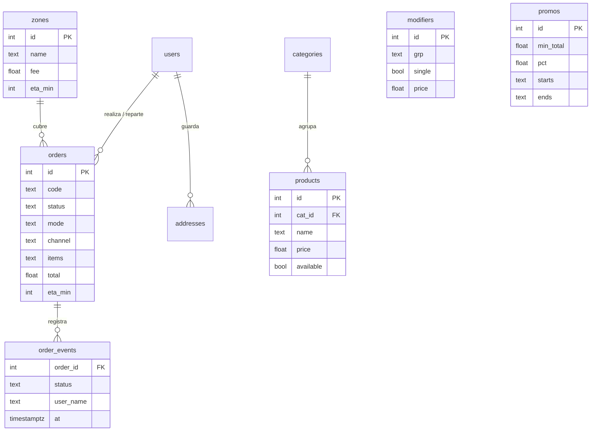

# Arquitectura y trazabilidad

## Estilo
Cliente-servidor en tres capas: SPA (navegador) → API REST Express → PostgreSQL. Un único modelo de datos sirve a la zona pública (cliente) y a la interna (personal).
Las actualizaciones de cocina, despacho y reparto llegan por **Server-Sent Events** (sin recargar, RF-26) con *polling* de respaldo.

## Modelo de datos

## Ciclo de vida del pedido
`Recibido → Confirmado → En preparación → Listo → En camino → Entregado` (en recojo/mesa se omite *En camino*); terminales: `Cancelado`, `Rechazado`.
Cada transición valida el **rol responsable** y guarda marca de tiempo y usuario (`order_events`, RNF-02).

## Trazabilidad requisitos → implementación
| Requisitos | Dónde |
|---|---|
| RF-01..05 Catálogo, disponibilidad, modificadores, combos, incompatibilidades | `GET /api/menu`, `POST /api/orders` (validación), `openProd()` |
| RF-06..17 Carrito, total, modalidades, cobertura, notas, pago, promos, horario, ETA, seguimiento, cancelación | `POST /api/orders`, `GET /api/track/:code`, `openCart()`, `viewTrack()` |
| RF-18..21 Cuenta, invitado, direcciones, historial y repetir | `/api/auth/*`, `/api/me/*`, `viewAccount()` |
| RF-22..26 Pantalla de cocina | `viewKitchen()`, SSE `/api/stream` |
| RF-27..30 Despacho y reparto | `viewDispatch()`, `viewCourier()`, `PATCH /api/orders/:id/assign` |
| RF-31..33 Mostrador | `viewCounter()` (reutiliza la carta, canal `mostrador`) |
| RF-34..38 Administración | `/api/admin/*`, `viewAdmin()` |
| RF-39..42 Reportes y exportación CSV | `/api/admin/reports/summary` |
| RNF-01 Sin pérdida ni duplicados | clave de idempotencia (`orders.idem`) |
| RNF-02 Trazabilidad | `order_events` |
| RNF-03/04 Rendimiento | SSE + consultas simples |
| RNF-07 Cocina legible a 1,5 m | tarjetas grandes, un botón por transición |
| RNF-08/16 Móvil sin instalar | CSS mobile-first, PWA opcional |
| RNF-10..12 Seguridad | JWT + roles, bcrypt, la cocina no recibe datos personales |
| RNF-15 Mantenibilidad | carta, precios, promos y horarios desde Administración |

## Paleta
Carbón `#16181f` (marca) · Mostaza `#ffb400` (acción) · Pepinillo `#2e9e5b` (éxito/listo) · Tomate `#e5372b` (alerta) · Papel `#f6f5f0` (fondo).
